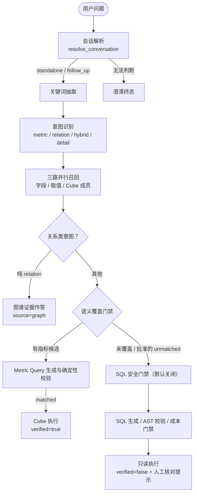

<div align='center'>
  <h1 style="margin-top: 15px;">【慧析】智能数据分析 Agent</h1>
  <h4><b>Intelligent-number-inquiry</b></h4>
</div>

<div align='center'>


[](LICENSE)

</div>

## 📖 项目介绍

在问数场景里，业务人员不会写 SQL，数据分析师也很难记住所有表结构、字段含义、指标口径和字段取值。把自然语言直接交给大模型，容易出现表选错、字段选错、指标理解错和 SQL 幻觉。

`慧析` 是一个面向电商数仓的企业级智能问数项目：

- 用户用自然语言提问（支持同一会话内追问）
- 系统按当前用户的权限快照召回相关字段、Cube 受治理成员和字段取值，关系类问题补充知识图谱证据
- 可表达的受治理指标优先编译为 Cube Metric Query 执行；语义未覆盖时才进入受控的 SQL 安全链路
- 全过程以 SSE 流式返回执行进度、路由来源、验证状态和查询结果

## ✨ 项目亮点

- **治理优先的混合问数，而不是模型直出 SQL**
    - 受治理指标由 Cube 语义层统一定义与执行，结果标记 `verified=true`；Text-to-SQL 仅是默认关闭、需显式授权的安全兜底。
- **检索 + 推理 + 确定性校验的完整链路**
    - Qdrant 负责字段和 Cube 成员语义召回，Elasticsearch 负责字段取值全文检索，MySQL 保存权威结构化元数据；模型输出必须经过严格 IR / AST 校验才能执行。
- **企业级认证授权与数据隔离**
    - Keycloak OIDC 严格 JWT 校验 + PyCasbin 版本化策略；指标、表、列、部门四级权限贯穿召回、模型上下文与执行边界，Cube 执行侧独立追加部门过滤。
- **业务知识图谱**
    - Meta MySQL 按发布版本保存技术血缘与业务聚合图谱（客户分层、偏好、热销区域、指标证据），Neo4j 为可选查询后端；图谱证据只辅助理解，不授予任何执行权限。
- **面向生产的工程能力**
    - 元数据版本发布 / 回滚 / 一致性检查、Redis 通用缓存与 SSE 断线重放、MinIO 大结果导出、查询审计、Prometheus / Grafana 可观测性、评测门禁。

## 🏗️ 系统架构



项目围绕两条主线展开：

| 主线         | 做什么                                                                     | 涉及模块                                               |
| ------------ | -------------------------------------------------------------------------- | ------------------------------------------------------ |
| 检索知识构建 | 抽取数仓表 / 字段 / 取值，把 Cube 受治理成员原子同步到向量集合，构建知识图谱 | `MySQL` / `Qdrant` / `Elasticsearch` / `Cube` / `TEI`  |
| 自然语言问数 | 按权限快照召回上下文，优先执行受治理指标，受控兜底 SQL，并把过程流式返回前端 | `LangGraph` / `FastAPI` / `SSE` / `Keycloak` / `React` |

问数执行链路（LangGraph 编排）：



问数执行链路详图（LangGraph 节点与门禁分支）：



- 会话解析失败自动降级为独立查询，不阻断问数；无法安全判断时返回澄清提示。
- 召回结果先按权限快照过滤，再进入模型上下文；`unknown_member` 等确定性校验错误不允许回退。
- 治理链路失败（`cube_timeout` / `metadata_out_of_sync` 等）不会自动绕过到 SQL。

## 🛠️ 技术栈

| 模块         | 技术                                                         |
| ------------ |------------------------------------------------------------|
| 后端框架     | `FastAPI`（路由 / 依赖注入 / 生命周期 / SSE）                          |
| 智能体编排   | `LangGraph` + `LangChain`                                  |
| 身份认证     | `Keycloak 26` OIDC / JWKS 严格 JWT 校验                        |
| 权限控制     | `PyCasbin` + Meta MySQL 版本化策略                              |
| 指标治理     | `Cube Core v1.7`（公开 `ecommerce` 语义视图）                      |
| 结构化存储   | `MySQL`（元数据库 `meta` + 模拟数仓 `dw`）/ SQLAlchemy 2.0           |
| 向量检索     | `Qdrant`（字段集合 + Cube 成员稳定 alias）                           |
| 全文检索     | `Elasticsearch`（字段取值索引）                                    |
| Embedding    | `TEI` / `BAAI/bge-large-zh-v1.5`                           |
| 缓存 / 重放  | `Redis 7.4`（通用缓存 + SSE frame 断线重放）                         |
| 结果导出     | `MinIO`（超出 SSE 内联阈值的大结果 JSON）                              |
| 图谱存储     | Meta MySQL（权威源）；`Neo4j` Community 可选查询后端                   |
| 可观测性     | 进程内指标 + `Prometheus` / `Grafana`                           |
| 前端         | `React 19` / `Vite` / `Tailwind CSS`，keycloak-js PKCE      |
| 日志 / 配置  | `loguru` + `ContextVar` request_id；`OmegaConf` + dataclass |
| 依赖管理     | `uv`（Python `>= 3.12`）/ `pnpm`                             |

## 📁 项目结构

```text
Intelligent-number-inquiry/
├── app/
│   ├── agent/            # LangGraph 图、状态、上下文和 26 个节点
│   ├── api/              # FastAPI 路由、依赖注入、生命周期和请求结构
│   ├── clients/          # MySQL / Qdrant / ES / Embedding / Cube / Keycloak / Redis / MinIO / Neo4j 客户端管理
│   ├── conf/             # 配置 dataclass 与加载工具
│   ├── core/             # 日志、request_id、资源预算、进程内指标
│   ├── entities/         # 业务数据对象
│   ├── evaluation/       # 评测执行器（隔离身份调用 QueryService）
│   ├── models/           # SQLAlchemy ORM 模型
│   ├── observability/    # Prometheus 指标导出
│   ├── prompt/           # Prompt 加载工具
│   ├── repositories/     # MySQL / Qdrant / ES / Cube / Redis / MinIO / Neo4j 数据访问层
│   ├── scripts/          # 构建、同步、发布、回滚、评测、基准脚本
│   ├── security/         # JWT 校验、授权依赖、SQL 策略引擎、时间范围解析
│   └── services/         # 问数、元数据、语义模型、图谱、用户、缓存等服务
├── conf/                 # app_config.yaml、meta_config.yaml
├── cube/                 # Cube 语义模型 YAML（受治理指标唯一事实来源）
├── docker/               # Compose、MySQL 初始化与迁移 SQL、Keycloak realm、ES 插件
├── docs/                 # 架构图、runbooks、production-roadmap、学习记录
├── frontend/             # React + Vite + Tailwind CSS 前端
├── prompts/              # 关键词抽取、SQL 生成 / 修正等 Prompt 模板
├── tests/                # pytest 测试
├── main.py               # FastAPI 应用入口
└── pyproject.toml        # Python 依赖与工具配置
```

## 🚀 快速开始

### 1. 环境要求

- Python `>= 3.12` 与 `uv`
- Docker 与 Docker Compose
- Node.js 与 `pnpm`

### 2. 安装依赖并配置环境

```bash
git clone https://github.com/exunknown/Intelligent-number-inquiry.git
cd Intelligent-number-inquiry
uv sync
cp .env.example .env
```

在 `.env` 中按分组填写：MySQL、LLM / INI 网关与模型、Cube（`CUBE_API_SECRET` / 只读账号）、OIDC 与 Keycloak Admin、Redis / MinIO、`METRICS_TOKEN`。首次验收保持 `SQL_FALLBACK_ENABLED=false`。不要把真实值提交到版本库，也不要在日志或排查输出中打印。

### 3. 准备 Embedding 模型

模型文件较大，需先下载到 Docker 挂载目录：

```bash
uv run hf download BAAI/bge-large-zh-v1.5 --local-dir docker/embedding/bge-large-zh-v1.5
```

### 4. 启动基础设施

```bash
docker compose --env-file .env -f docker/docker-compose.yaml up -d
docker compose --env-file .env -f docker/docker-compose.yaml ps   # 确认全部 healthy
```

> 升级已有 MySQL volume 时，初始化脚本不会自动重跑，需要按顺序手工执行
> `docker/mysql/migrations/` 下的幂等迁移和两个只读账号脚本；

### 5. 构建检索知识

```bash
uv run python -m app.scripts.import_semantic_model --source cube/model --release-version <版本>   # 预览
uv run python -m app.scripts.build_meta_knowledge -c conf/meta_config.yaml
uv run python -m app.scripts.bootstrap_metadata_aliases
uv run python -m app.scripts.sync_cube_metadata
```

- `build_meta_knowledge`：表字段写 Meta MySQL，字段向量写 Qdrant，`sync: true` 的字段取值写 ES。
- `bootstrap_metadata_aliases`：幂等建立字段 / legacy 指标 / 字段值稳定 alias。
- `sync_cube_metadata`：从鉴权的 Cube metadata API 提取公开成员，staging 集合 + 原子 alias 切换；**每次修改 Cube model 后必须重跑**。

### 6. 启动后端与前端

```bash
uv run fastapi dev main.py        # 后端 http://127.0.0.1:8000
cd frontend && pnpm install && pnpm dev   # 前端 http://127.0.0.1:3000
```

前端通过 Vite 代理把 `/api` 转发到 `http://127.0.0.1:8000`；`frontend/.env` 中的
`VITE_KEYCLOAK_URL` 必须与 Keycloak 实际宿主端口一致，修改后需重启 Vite。

### 默认端口

| 服务           | 端口                                |
| -------------- | ----------------------------------- |
| 后端 API       | `8000`                              |
| 前端开发服务器 | `3000`（Windows 避开 5173 端口排除范围） |
| MySQL          | `3307`                              |
| Keycloak       | `8180`                              |
| Cube           | `4000`                              |
| Elasticsearch  | `19200`（容器内 `9200`）            |
| Kibana         | `55601`                             |
| Qdrant         | `6333`（HTTP）/ `6334`（gRPC）      |
| Embedding      | `18081`                             |
| Redis          | `6379`                              |
| MinIO          | `9000`（API）/ `9001`（控制台）     |
| Prometheus     | `9090`                              |
| Grafana        | `3001`                              |
| Neo4j          | `7474` / `7687`（仅 `neo4j` profile） |

> 均为宿主机端口；Keycloak 改用其他宿主端口需同步
> `OIDC_ISSUER` / `OIDC_JWKS_URL` / `KEYCLOAK_ADMIN_BASE_URL` 和前端
> `VITE_KEYCLOAK_URL`。

### 可选：知识图谱与 Neo4j

```bash
uv run python -m app.scripts.build_business_knowledge_graph --release-version <版本>
docker compose --env-file .env --profile neo4j -f docker/docker-compose.yaml up -d neo4j
uv run python -m app.scripts.sync_knowledge_graph_to_neo4j --release-version <版本>
```

默认 `KNOWLEDGE_GRAPH_ENABLED=false`、查询后端为 Meta MySQL；只有 Neo4j 完成初始化并显式设置
`NEO4J_ENABLED=true` + `KNOWLEDGE_GRAPH_BACKEND=neo4j` 后才切换。图谱不可用只产生降级进度，
不改变问数终态，也不绕过权限门禁。

## 🔌 对外接口

除探针与 `/metrics` 外，业务接口均要求 Keycloak 签发的 Bearer Token 和对应 Casbin 权限。

| 分组     | 接口                                                                    | 说明                                   |
| -------- | ----------------------------------------------------------------------- | -------------------------------------- |
| 问数     | `POST /api/query`                                                       | SSE 流式问数，支持可选 `session_id`    |
| 会话     | `POST/GET /api/sessions`、`GET /api/sessions/{id}`                      | 按用户归属隔离的脱敏历史摘要           |
| 断线重放 | `GET /api/query/events/{request_id}`                                    | 携带 `Last-Event-ID` 重放保留的 SSE 帧 |
| 结果导出 | `GET /api/exports/{export_id}`                                          | 校验用户归属、策略版本与过期时间       |
| 指标目录 | `GET /api/metrics`                                                      | 受治理成员只读目录，按权限过滤         |
| 治理候选 | `GET /api/metric-candidates`、`POST /api/metric-candidates/{id}/review` | 未命中问题的候选池与审核闭环           |
| 授权管理 | `/api/admin/authz/**`                                                   | 版本化策略与有效权限预览               |
| 用户管理 | `/api/admin/users/**`                                                   | Keycloak 编排 + 本地档案，幂等写       |
| 语义模型 | `/api/admin/semantic-model/**`                                          | 语义快照、校验、审核、发布与回滚       |
| 知识图谱 | `/api/admin/knowledge-graph/**`                                         | 版本、节点、子图与三视图只读接口       |
| 探针     | `GET /health/live`、`GET /health/ready`                                 | 免认证；未就绪返回 503                 |
| 指标导出 | `GET /metrics`                                                          | 独立 `METRICS_TOKEN`，低基数标签       |

### SSE 协议

`POST /api/query` 返回 `text/event-stream`，每帧带标准 `id` 与协议注释，服务端保证最多一个终态事件：

| 类型        | 含义                                                       |
| ----------- | ---------------------------------------------------------- |
| `progress`  | 节点执行进度，可选 `message` 过程提示                      |
| `metrics`   | 本次查询的指标展示项（字符串或结构化 member 信息）         |
| `route`     | 最终执行模式（`metric` / `sql` / `graph`）及原因，非终态   |
| `result`    | 最终结果，含 `source`、`verified`、`warning`、可选 `export_id` |
| `error`     | 稳定错误，含 `code`、`message`、`retryable`                |
| `heartbeat` | 长连接保活，不改变查询状态                                 |

主要错误码：`conversation_clarification_required`（需澄清）、`unknown_member` /
`invalid_model_output`（确定性校验拒绝）、`cube_timeout` / `cube_unavailable` /
`cube_unauthorized` / `metadata_out_of_sync`（治理链路失败，不走 SQL）、
`sql_security_not_ready`（SQL fallback 未就绪）、`sql_rejected` / `sql_cost_exceeded` /
`sql_timeout` / `sql_result_too_large` / `sql_execution_failed`（SQL 安全链路拒绝或失败）。

## 🔒 安全边界

- **认证授权**：后端严格校验 RS256 签名、issuer、audience 与过期时间；禁用用户返回 403。
  无部门数据范围的问数请求返回 `403/no_data_scope`。
- **执行隔离**：Cube 令牌携带真实用户、排序后的部门范围与策略版本，`queryRewrite` 在执行
  边界独立追加部门过滤。
- **SQL fallback**：默认关闭。开启后模型 SQL 仍须经 SQLGlot MySQL AST 白名单校验、表列权限、
  部门谓词与相对时间范围强制注入、JSON EXPLAIN 成本门禁、超时 / 行数 / 字节预算；使用独立
  只读连接池与专用账号，自动修正最多一次且必须重新校验。
- **审计**：每次已授权问数将身份、策略版本、部门范围、路由、SQL、验证状态、错误码与耗时写入
  Meta MySQL `query_audit`；不保存访问令牌、连接串或密钥，写入失败不改变查询结果。

## 🧪 治理、发布与评测

```bash
uv run python -m app.scripts.publish_metadata_release --version <版本> --db-migration-version <迁移号> --conf conf/meta_config.yaml
uv run python -m app.scripts.rollback_metadata_release --version <已验证版本>
uv run python -m app.scripts.check_metadata_release
```

- 发布先把 Qdrant / ES / 图谱写入版本化 staging 并验数，再在发布锁内顺序切换稳定 alias、
  激活不可变 manifest；失败会反向补偿，跨存储不宣称单一事务。
- 评测门禁：`run_evaluation` 用脱敏黄金集与观测 JSONL 生成报告，支持 `--baseline` 回归门禁；
  安全拒答率回退或版本不一致时返回非零。
- 可观测性：Prometheus 通过 Docker secret 抓取 `/metrics`（不复用用户令牌），Grafana 自动
  加载数据源与「Shopkeeper 问数服务」看板；告警规则见 `docs/runbooks/observability.md`。

## 🔁 升级与回滚

- 回滚 Cube 指标链路：停止 Cube，恢复上一版图编排、Cube model 与配置后按快速开始顺序重启。
- SQL fallback 回滚优先 `SQL_FALLBACK_ENABLED=false` 并重启；审计新增列保留，账号由运维确认后撤销。
- Qdrant 清理范围仅限 `cube_member_collection` alias 与本次生成的 `cube_member_*` 物理集合。
- 兼容保留（dormant）：`MetricConfig`、Meta MySQL 指标表、旧 Qdrant metric repository，
  以及 `filter_table` / `filter_metric` / `recall_metric` 节点文件，不删除、不参与当前图。

## 🚧 能力边界

认证授权（阶段 01）与 SQL 安全执行（阶段 02）代码、迁移与自动化回归已完成；打开 SQL fallback
仍需注入正式只读账号凭据并完成浏览器验收。继续面向生产可扩展：

- 多实例下的分布式准入与限流
- 更大规模的评测集与 CI 自动回归
- 链路追踪、告警通知渠道与灰度发布
- 多轮问数的异步导出队列
